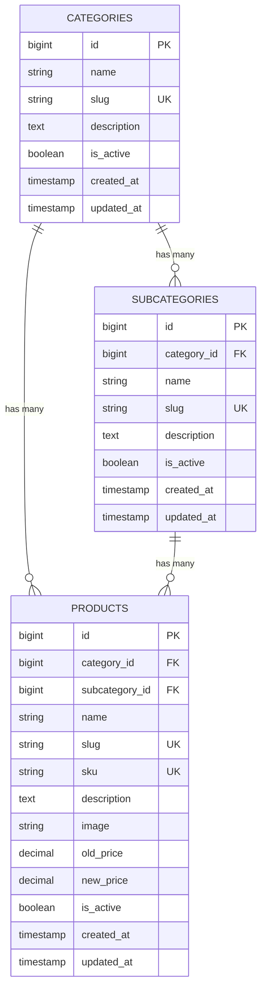

# Simplified E-commerce Platform Development

> **Technical Assessment Submission for Mid-Level Laravel Developer Position**  
> **Company:** Bangla Puzzle Limited  
> **Candidate:** Md Naimul Hasan Naeem  
> **Email:** [naimulhasan312005@gmail.com](mailto:naimulhasan312005@gmail.com)  
> **GitHub Repository:** [https://github.com/naeem312005/E-commerce-Platform-Development](https://github.com/naeem312005/E-commerce-Platform-Development)  
> **Submission Deadline:** 11:59 PM, 08 November 2026

---

## 📋 Project Overview & Architecture

This application is a robust, simplified e-commerce management platform built with modern **Laravel 13**, **Blade Template Engine**, and **Tailwind CSS**. It provides full CRUD operations for Categories, Subcategories, and Products, enforcing relational data integrity, clean architecture, and SEO-friendly slugged URLs.

### 🌟 Implemented Requirements Matrix

| Requirement | Implementation Detail | Status |
| :--- | :--- | :--- |
| **1. Category Management** | Full CRUD, unique name validation, automatic SEO slug generation, active toggle, subcategory/product count tracking. | ✅ Complete |
| **2. Subcategory Management** | Full CRUD under parent category, Eloquent `belongsTo`/`hasMany` relationships, cascade constraint protection, slugging. | ✅ Complete |
| **3. Product Management** | Dynamic dependent category-to-subcategory dropdown, image upload to disk with instant live preview, Old/New price validation (`new_price <= old_price`), SKU generation, DB transactions. | ✅ Complete |
| **4. Product Showcase & SEO Details** | Products organized by their respective subcategories (Showcase page), SEO-friendly URLs (`/products/{slug}`), Breadcrumbs, savings calculation, related items. | ✅ Complete |
| **5. Complete CRUD & Data Integrity** | Foreign key constraints (`onDelete('cascade')`), database transactions on write/delete, automatic orphaned image file cleanup. | ✅ Complete |
| **Code Quality & Testing** | **PHPStan Level 7 (0 errors)**, **Laravel Pint** PSR-12 code style, **48 Automated PHPUnit Feature Tests** passing. | ✅ Complete |
| **Database Export** | Standalone SQL dump included at root `ecommerce.sql` and `database/ecommerce.sql`. | ✅ Complete |

---

## 🗄️ Database Architecture & Relationships (ERD)



---

## 🚀 Quick Setup Instructions (Local Environment)

### Prerequisites
- **PHP:** `^8.3` or `^8.4` (with PDO, OpenSSL, Mbstring, Exif, GD extensions)
- **Composer:** `^2.x`
- **Node.js:** `^20.x` or `^22.x` & **NPM**
- **Database:** MySQL 8.0+ / MariaDB 10.5+

### Step-by-Step Installation

1. **Clone the repository:**
   ```bash
   git clone https://github.com/naeem312005/E-commerce-Platform-Development.git
   cd E-commerce-Platform-Development
   ```

2. **Install PHP and Node dependencies:**
   ```bash
   composer install
   npm install
   ```

3. **Configure Environment:**
   ```bash
   cp .env.example .env
   php artisan key:generate
   ```
   *Edit `.env` and configure your database credentials:*
   ```env
   DB_CONNECTION=mysql
   DB_HOST=127.0.0.1
   DB_PORT=3306
   DB_DATABASE=ecommerce_db
   DB_USERNAME=root
   DB_PASSWORD=
   ```

4. **Create Symbolic Storage Link (for product images):**
   ```bash
   php artisan storage:link
   ```

5. **Run Migrations & Seed Realistic Sample Data:**
   ```bash
   php artisan migrate:fresh --seed
   ```
   *(Alternatively, you can import the provided `ecommerce.sql` file directly into your MySQL database).*

6. **Build Frontend Assets:**
   ```bash
   npm run build
   ```

7. **Start the local server:**
   ```bash
   php artisan serve
   ```
   Visit: `http://127.0.0.1:8000`

---

## 🔐 Default Access Credentials

Pre-seeded admin accounts ready for testing:

- **Admin Email:** `admin@banglapuzzle.com`
- **Alternative Email:** `naimulhasan312005@gmail.com`
- **Password:** `password`

---

## 🧪 Automated Testing & Code Quality Verification

All tests are verified and passed:

```bash
# Run PHPUnit Feature & Unit Test Suite (48 tests, 158 assertions)
php ./vendor/bin/phpunit

# Run Static Analysis (PHPStan / Larastan at Level 7)
php ./vendor/bin/phpstan analyse --memory-limit=512M

# Run Code Style Linter (Laravel Pint)
php ./vendor/bin/pint --test

# Run Vue TypeScript Checking
npm run types:check
```

---

## 🖥️ VPS Server Management & Deployment Guide

As requested in the job requirements regarding **practical experience in VPS server management and deployment**, below is the standard production deployment blueprint for deploying this Laravel application on an **Ubuntu 24.04 LTS / Debian VPS** with **Nginx**, **PHP-FPM**, and **Let's Encrypt SSL**.

### 1. Initial VPS Server Hardening
```bash
# Update repositories and packages
sudo apt update && sudo apt upgrade -y

# Configure uncomplicated firewall (UFW)
sudo ufw default deny incoming
sudo ufw default allow outgoing
sudo ufw allow 22/tcp    # SSH
sudo ufw allow 80/tcp    # HTTP
sudo ufw allow 443/tcp   # HTTPS
sudo ufw enable
```

### 2. Install Nginx, PHP 8.3-FPM, MySQL & Tools
```bash
sudo apt install -y nginx git curl unzip supervisor certbot python3-certbot-nginx
sudo add-apt-repository ppa:ondrej/php -y
sudo apt update
sudo apt install -y php8.3-fpm php8.3-mysql php8.3-mbstring php8.3-xml php8.3-bcmath \
    php8.3-curl php8.3-gd php8.3-zip php8.3-intl php8.3-sqlite3
```

### 3. Deploying the Application Code
```bash
# Clone to webroot
cd /var/www
sudo git clone https://github.com/naeem312005/E-commerce-Platform-Development.git ecommerce
cd /var/www/ecommerce

# Set file ownership and permissions
sudo chown -R www-data:www-data /var/www/ecommerce
sudo chmod -R 775 /var/www/ecommerce/storage /var/www/ecommerce/bootstrap/cache

# Production Composer & NPM Build
sudo -u www-data composer install --no-dev --optimize-autoloader
npm install && npm run build

# Environment & Migrations
cp .env.example .env
php artisan key:generate
php artisan storage:link
php artisan migrate --force --seed
php artisan config:cache
php artisan route:cache
php artisan view:cache
```

### 4. Production Nginx Virtual Host Configuration
`/etc/nginx/sites-available/ecommerce.conf`:
```nginx
server {
    listen 80;
    server_name your-domain.com www.your-domain.com;
    root /var/www/ecommerce/public;

    add_header X-Frame-Options "SAMEORIGIN";
    add_header X-Content-Type-Options "nosniff";
    add_header X-XSS-Protection "1; mode=block";

    index index.php;
    charset utf-8;
    client_max_body_size 20M; # Accommodates high-res product photos

    location / {
        try_files $uri $uri/ /index.php?$query_string;
    }

    location = /favicon.ico { access_log off; log_not_found off; }
    location = /robots.txt  { access_log off; log_not_found off; }

    error_page 404 /index.php;

    location ~ \.php$ {
        fastcgi_pass unix:/var/run/php/php8.3-fpm.sock;
        fastcgi_param SCRIPT_FILENAME $realpath_root$fastcgi_script_name;
        include fastcgi_params;
        fastcgi_hide_header X-Powered-By;
    }

    location ~ /\.(?!well-known).* {
        deny all;
    }
}
```

```bash
sudo ln -s /etc/nginx/sites-available/ecommerce.conf /etc/nginx/sites-enabled/
sudo nginx -t
sudo systemctl reload nginx
```

### 5. SSL Certificate Setup (Let's Encrypt)
```bash
sudo certbot --nginx -d your-domain.com -d www.your-domain.com
```

### 6. Queue & Scheduler Worker (Supervisor)
`/etc/supervisor/conf.d/laravel-worker.conf`:
```ini
[program:laravel-worker]
process_name=%(program_name)s_%(process_num)02d
command=php /var/www/ecommerce/artisan queue:work --sleep=3 --tries=3 --max-time=3600
autostart=true
autorestart=true
stopasgroup=true
killasgroup=true
user=www-data
numprocs=2
redirect_stderr=true
stdout_logfile=/var/www/ecommerce/storage/logs/worker.log
stopwaitsecs=3600
```
```bash
sudo supervisorctl reread
sudo supervisorctl update
sudo supervisorctl start all
```

---

## 📦 Project Submission Checklist

- [x] Full CRUD for **Category Management** (with Form Validation).
- [x] Full CRUD for **Subcategory Management** (with Category Database Relationship).
- [x] Full CRUD for **Product Management** (Category, Subcategory, Name, Description, Image Upload, Old Price, New Price).
- [x] Product Showcase organized by respective subcategories.
- [x] SEO-Friendly URLs using Slugs (`/products/{slug}`).
- [x] Individual Product Details view.
- [x] Referential database integrity & foreign keys.
- [x] Database SQL dump file (`ecommerce.sql`).
- [x] Comprehensive documentation and VPS deployment architecture.

---
*Developed with ❤️ by Md Naimul Hasan Naeem for Bangla Puzzle Limited.*
